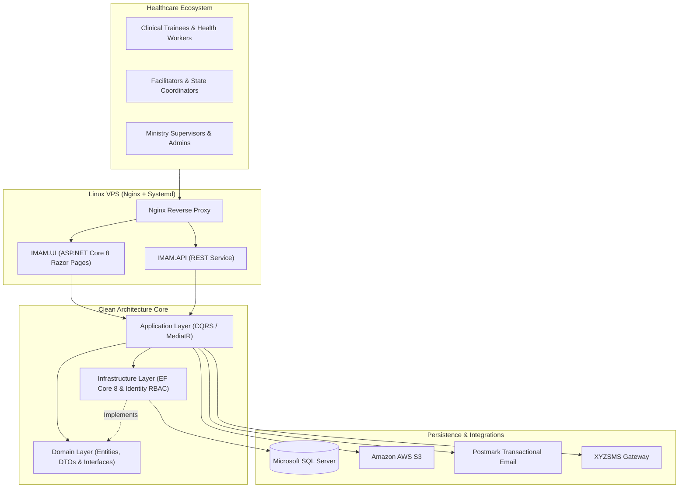

# IMAM — National Integrated Management of Acute Malnutrition Training MIS

[](https://dotnet.microsoft.com/)
[](#system-architecture)
[](#technology-stack)
[](#technology-stack)
[](#ci-cd--security-governance)

An enterprise **National Health Capacity-Building, Competency Testing, and Verifiable Certification Management Information System (MIS)** engineered for the **Integrated Management of Acute Malnutrition (IMAM)** program across Nigeria under **Federal Ministry of Health and Social Welfare** standards.

Part of a national clinical nutrition training ecosystem serving **12,000+ healthcare workers, facilitators, and supervisors**, the platform automates multi-state cohort scheduling, attendance tracking, pre-/post-training clinical assessments, supervisory quality assurance, and tamper-evident digital certificates.

---

## Key Operational Capabilities

- **Multi-State Clinical Cohort Management**: Coordinates concurrent national and state-level training batches, modular clinical curricula, facilitators, and healthcare participants.
- **Pre-Test & Post-Test Clinical Competency Engine**: Automated administration and grading of standardized pre-training and post-training assessments to measure practitioner knowledge gains.
- **Supervisory Field QA & Daily Evaluations**: Structured daily trainee evaluations and supervisor compliance checklists across training centers.
- **Verifiable Digital Credentialing**: Generates official PDF completion certificates (`Rotativa.AspNetCore`) with public credential verification.
- **Clean Architecture + CQRS (`MediatR`)**: Strict separation across `Domain`, `Application`, `Infrastructure`, cloud/messaging adapters (`AWS`, `PostmarkEmailService`, `XYZSMS`), and `IMAM.UI`.

---

## System Architecture



---

## Solution Structure

```text
IMAM/
├── .github/workflows/
│   └── deploy.yml                 # Automated Linux x64 self-contained build & SSH/SCP deployment
├── src/
│   ├── Domain/                    # Enterprise entities, DTOs, enums, and repository contracts
│   ├── Application/               # CQRS Commands, Queries, and MediatR handlers
│   ├── Infrastructure/            # EF Core 8 DbContext, migrations, and SQL Server repositories
│   ├── API/                       # Companion REST API project
│   ├── AWS/                       # Amazon S3 cloud document/media service
│   └── PostmarkEmailService/      # Transactional email client
├── XYZSMS/                        # SMS notification integration library
├── UI/
│   └── IMAM.UI/                   # Primary ASP.NET Core 8 Razor Pages web portal
├── tests/
│   └── Test/                      # Automated unit/integration tests
├── .env.example                   # Sanitized environment configuration template
├── deploy.sh                      # Systemd provisioning, port discovery & health verification script
└── IMAM.sln                       # Visual Studio Solution
```

---

## Technology Stack

- **Framework**: C#, .NET 8, ASP.NET Core Razor Pages & Web API
- **Architectural Pattern**: Clean Architecture, CQRS (`MediatR`), Repository Pattern
- **Database**: Microsoft SQL Server, Entity Framework Core 8
- **Security**: ASP.NET Core Identity (`AppUser`, `AppRole`), RBAC, Environment-Isolated `.env` Secrets
- **Cloud & Comms**: Amazon S3, Postmark Email API, XYZSMS Gateway, `Rotativa.AspNetCore`
- **DevOps**: GitHub Actions CI/CD, Linux `systemd` (`imam.service`), Bash (`deploy.sh`), Nginx

---

## Local Development Setup

### 1. Clone & Configure Environment
```bash
git clone https://github.com/VS-GitHub-001/IMAM.git
cd IMAM
cp .env.example UI/IMAM.UI/.env
```
Populate `UI/IMAM.UI/.env` with your local SQL Server connection string and service keys.

### 2. Build, Migrate & Run
```bash
dotnet restore UI/IMAM.UI/IMAM.UI.csproj
dotnet build UI/IMAM.UI/IMAM.UI.csproj --configuration Release
dotnet ef database update --project src/Infrastructure --startup-project UI/IMAM.UI
dotnet run --project UI/IMAM.UI
```

---

## CI/CD & Security Governance

Production releases run via [`.github/workflows/deploy.yml`](.github/workflows/deploy.yml) and [`deploy.sh`](deploy.sh), preserving the live server's `/var/www/imam/.env` (`chmod 600`) across deployments while keeping source control 100% free of credentials.

---

## Author

**Peter Emeka Onwuka**  
Chief Technology Officer & Enterprise Systems Architect  
- GitHub: [@SirP-TechHub-0904](https://github.com/SirP-TechHub-0904)  
- LinkedIn: [Peter Emeka Onwuka](https://www.linkedin.com/in/onwuka-peter-emeka)

